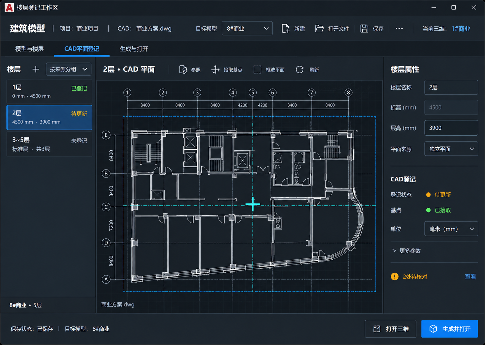

# 建筑模型统一工作台

日期：2026-10-15；安装更新：2026-10-16。用户选择本轮第三张设计稿作为主方向。CAD 工作台现已实现、完成正式编译和隔离测试，并经本轮关闭确认后备份覆盖原安装；Studio 管理页本轮未改版。详见 [实现与验证](../../reviews/建筑模型统一工作台-2026-10-15.md)，产品版本仍为 1.5.6。下文保留完整目标交互规范，不代表每一项均已完成用户真实项目验收。

## 统一布局

- CAD“建筑模型”入口直接进入工作台，取消先选五个功能再点“继续”的中转窗口。
- 顶部固定显示项目、当前 CAD、目标模型，以及新建、打开文件、保存和更多操作；目标模型下拉可搜索，并区分当前 CAD 关联模型与项目全部模型。
- “当前三维”单独标明实际打开的模型，不能与当前查看的目标模型混淆。
- 同一窗口三个视图：“模型与楼层”“CAD 平面登记”“生成与打开”。可直接切换，不是必须依次完成的向导；保留所选模型、楼层和草稿。
- 登记视图左侧为楼层及标准层组，中间为平面和基点预览，右侧为所选楼层属性。底部固定显示保存状态及操作目标。
- 模型管理融入顶部下拉和“模型与楼层”视图，不再另外弹出重复的管理主页。另存为、模型文件位置、字段校验归入更多菜单或相应详情，不挤占主要流程。

## 三个视图

### 模型与楼层

同一工作区查看当前 CAD 关联的模型、添加已有模型或新建模型。选定模型后，主体显示可编辑楼层表，右侧显示所选楼层属性；模型名称、保存位置和关联图纸放在模型详情中。

新增楼层菜单包含普通层、地下层、标准层、屋顶和机房。标准层显示范围、代表层数及共用平面来源；首层标高依照现有标高算法推算，不能将每层改成一个独立模型。删除和改变共用来源时，先说明受影响的楼层和构件再提交。

新建在本工作区展示名称与初始楼层设置；“创建模型”保存一个独立空模型，并留在当前工作台继续登记。允许直接打开空模型，不要求先有可识别墙体。

### CAD 平面登记

切换左侧楼层，右侧属性同步更新。中间只显示真实已登记图元或当前捕捉预览；没有登记数据时用明确空状态，不能展示其他模型的图或随机生成预览。

“拾取基点”和“框选平面”暂时收起工作台，把操作交给 CAD；完成后自动回到原目标模型及楼层。取消拾取只取消本次操作，原登记和已保存内容保留。进入 CAD 前和返回后检查文档身份及目标模型，不能将另一张 DWG 的选择写入原模型。

右侧常用项为楼层名、层高、标高、平面来源、登记状态、基点及单位。坐标、楼板厚度、重新生成策略等放入“更多参数”，沿用现有取值及数据规则。方向沿当前 CAD 坐标系，不新增无依据的方向设置。

登记状态至少区分未登记、已登记、待更新、需核对，并同时给出文字和颜色。标准层组只登记一次，共用层可以查看来源，不重复框选。

### 生成与打开

显示目标模型、登记楼层范围、重新生成模式和待核对项。默认沿用“按 CAD 替换登记楼层”，另有“保留模型编辑，安全更新”；这两者作用于同一个模型，不是按楼层生成独立文件。

重登记继续遵守已批准规则：登记楼层其他构件按 CAD 替换；门窗编号和洞口尺寸相同则保留修改过的做法，位置按 CAD 重算；未登记楼层不动。处理异常识别时局部跳过并报告，不能因为没有可识别构件就阻止进入模型。

底部“打开三维”只打开现有结果，不暗中重生成；“生成并打开”明确提交所选目标，等待生成接收或失败反馈。已有窗口则激活或通过现有请求机制更新，不另起同一文件的编辑副本。

## 保存与切换

1. 选择目标模型只查看和编辑该目标，不立即切换 Studio 的当前模型。
2. 离开有草稿的模型或关闭工作台时，提供保存、放弃、取消；不自动抹掉输入。
3. “保存”明确保存当前目标的设置。已打开模型的最新内容由其会话保存并返回结果，不能拿磁盘旧文件覆盖未保存模型。
4. 应用后的修改不被 Esc 撤回；Ctrl+Z 才撤销。输入框中保持正常文本撤销，不能把 Esc 当全局撤销。
5. 捕捉、保存或生成过程中固定操作目标；完成前禁止重复提交与切换，取消后恢复原上下文。
6. 外部修改、模型路径失效、CAD 文档切换时展示具体状态，不自动退到另一个模型或猜测来源。

## CAD 与模型端

两端沿用相同模型清单、稳定模型身份和当前会话确认机制，不新建另一套管理数据。在模型端也沿用同样的新建、打开、保存和目标模型标识；CAD 拾取需要可用的对应文档，没有连接时显示连接状态，不伪造可用按钮。

## 视觉与验收

第三张图用于布局和交互层级参考，图中模型名、楼层和示意平面不是用户项目数据，也不表示已经接通预览。实现时使用现有主题和真实图元，图标沿用已打包资源；不将设计图片直接作为操作界面。

建议默认 1280×860，按屏幕工作区约束；窄窗口可折叠右侧属性，模型和楼层名称不裁掉关键身份，主操作始终可见。只给表格和预览内部滚动，不在底部堆一排超出屏幕的按钮。

后续实现基于现有 WPF CAD 窗口与 Avalonia 模型端，不另做网页作为正式产品。复用模型管理、楼层设置、CAD 登记、生成及会话服务，逐步替换旧入口。测试重点：一 CAD 多模型不串用、标准层、取消拾取、草稿保存/放弃、生成失败反馈、旧模型与重登记保留、大小窗口和高 DPI。安装仍需关闭确认、进程复查及备份原目录。

## 设计来源

使用内置图像生成工具，本轮第三个实际展示结果，源文件 `exec-da172731-a0fd-4a1f-aef4-b848c3c3cd38.png`。生成简述：以用户现有建筑模型入口截图为参考，绘制桌面深色楼层登记工作区，顶部选择模型、左侧楼层、中间真实风格 CAD 平面、右侧属性、底部打开三维及生成并打开；不新增云功能或外部资源能力。此目录保留选中结果，不包含用户原截图、真实 DWG、模型项目或本机配置。
