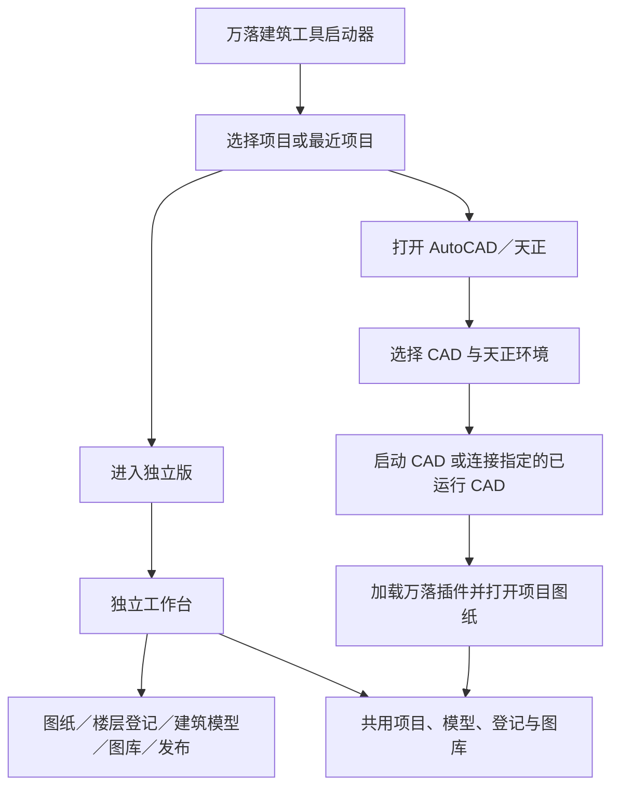

# 统一启动器与独立版双入口开发计划

日期为 2026-11-12。状态为 P0 和基础读图首批已备份安装。产品版本沿用 1.5.6。

用户后续明确图纸工作区需具备完整 MiniCAD 能力，并增加建筑专业功能。后续范围、UI 和实施顺序以 [完整 CAD 与建筑扩展计划](独立CAD完整功能与建筑扩展-2026-11-12.md) 为准，优先原生编辑内核和 WPF 桥接、编辑保存闭环。

本计划依据用户确定的使用流程编写，承接 [MiniCAD 技术评估与独立库实测](独立建筑软件与MiniCAD技术评估-2026-11-12.md)。

## 一、产品目标

用户打开现有“万落建筑工具启动器”，可以直接选择进入独立版，也可以选择 AutoCAD／天正环境继续工作。两个入口共用项目、建筑模型、楼层登记、图框登记、图纸顺序和本地构件图库。

独立版在未安装 AutoCAD 的 Windows 环境运行，逐步完成图纸打开、二维编辑、登记建模、三维编辑、模型导出和 PDF 发布。AutoCAD／天正入口继续提供现有插件协同能力。

启动器和独立工作台界面采用 WPF。正式发布的建筑模型编辑器为 .NET 8 Avalonia。首批通过同一模型文件接通现有三维编辑器，后续按模块整合画布和业务界面。

## 二、用户操作流程



### 启动独立版

1. 选择最近项目，或新建／打开项目。
2. 点击“进入独立版”。
3. 打开该项目的独立工作台，恢复上次图纸、模型和工作区。
4. 需要时打开其他 DWG／DXF、切换模型、登记楼层或创建建筑模型。

用户也可以先点击“进入独立版”，在工作台起始页选择项目。项目管理在两个入口之前和进入之后均可访问。

### 打开 AutoCAD／天正

1. 选择项目，点击“打开 AutoCAD／天正”。
2. 在 CAD 环境面板选择 AutoCAD 版本及天正产品，也可连接指定的已运行 CAD。
3. 启动器显示实际启动、等待空闲、加载插件和打开图纸的进度。
4. 进入 CAD 后，插件使用已选择的共用项目。

### 在两种环境之间继续工作

工作台提供“在 AutoCAD 中打开”，CAD 项目入口提供“在独立版中打开”。操作由用户点击发起，并传递当前项目、图纸及目标模型。

有未保存修改时提供保存、另存和取消。完成文件保存与修订核对后，目标环境读取最新磁盘版本。项目和模型使用原有身份继续关联。

## 三、启动器界面

```text
┌──────────────────────────────────────────────────────┐
│ 万落建筑工具                当前项目 [选择项目     ▾] │
│                                                      │
│ ┌──────────────────────┐  ┌───────────────────────┐ │
│ │  独立版              │  │  AutoCAD／天正        │ │
│ │  图纸与建筑模型工作台│  │  使用现有 CAD 环境    │ │
│ │  [进入独立版]        │  │  [打开 AutoCAD／天正] │ │
│ └──────────────────────┘  └───────────────────────┘ │
│                                                      │
│ 最近项目                         [新建项目] [打开项目]│
│ 项目名称       上次打开       [独立版打开] [CAD打开]  │
│ 项目名称       上次打开       [独立版打开] [CAD打开]  │
│                                                      │
│ [项目管理] [设置]                 同步状态／版本信息  │
└──────────────────────────────────────────────────────┘
```

- 两个入口同屏并列，操作名称直接表达进入的环境。
- 记住上次入口、项目及 CAD 组合，用于默认焦点和选项恢复。
- CAD 版本、天正产品、连接已有实例和随 CAD 自动加载等参数放在 CAD 环境面板。
- CAD 发现采用后台刷新。未安装 CAD 时，独立入口及项目管理正常可用，CAD 面板显示环境检测结果与手动定位入口。
- 最近项目的一行即可完成打开，完整路径放入提示或项目详情。
- 后台同步具有可见状态及明确的退出操作，进度信息与当前启动任务对应。
- 大小窗口、中文长名称及 100%／125%／150% 缩放纳入界面验收。

## 四、独立工作台界面

### 工作区

顶部采用现有功能区的术语，分为项目、绘图、建筑模型、图库、标注、出图和管理。左侧为项目浏览器，中间为图纸／平面／三维／图纸预览页签，右侧为属性，底部为命令、捕捉、坐标、单位和任务进度。

图纸列表显示项目中的 DWG／DXF、模型空间和布局。建筑模型列表显示当前 CAD 图纸所关联的多个模型，提供新建、打开、保存、另存、更新及模型管理。

### 楼层登记和模型更新

在一个工作台内完成新建／选择模型、楼层设置、基点、平面框选、识别结果预览和生成。

- 更新界面明确显示目标模型、登记楼层与替换范围。
- 新建模型显示名称与文件位置，同名时提供打开已有模型、确认替换及修改名称。
- 重新登记沿用现有替换规则。同编号、同洞口尺寸的门窗保留已编辑的分格、材料和构造，位置依据新平面重新计算，其余已登记楼层构件按既有规则替换。
- 部分识别失败时显示具体对象和原因，继续生成可用构件，保留底图并提供人工补绘入口。
- 绘制、应用、夹点提交、Esc 及 Ctrl+Z 沿用现有产品约定。

各阶段在界面上准确显示已经交付的能力范围。

## 五、共用数据与同时打开

### 项目与资源

两个入口继续使用现有项目管理与存储逻辑，项目、模型、登记及构件资源保持稳定 ID。图纸路径通过项目根目录解析，并兼容已有绝对路径关联。

CAD 与三维共用同一本地构件目录。CAD 平面、构件模型、分类、缩略图及四向立面围绕同一个资源条目管理。现有参数门窗、模板、标准层实例、房间统计和发布顺序进入兼容性回归。

### 保存与并行编辑

- 同一项目可在两种环境打开，不同图纸和不同模型可以分别编辑。
- 对同一 DWG／模型的写入采用文件级协调，打开时显示当前编辑环境，提供只读查看、另存副本或保存后交接。
- 保存前核对文档修订或文件哈希，临时文件写完后原子替换，记录变更来源。
- 外部修改出现时显示重新载入、对照或另存选项，用户草稿具有恢复记录。
- 项目清单更新按现有数据结构合并，模型数据、图纸内容及图库资源分别管理保存生命周期。
- 自动同步沿用共用后台及项目身份，识别编辑占用和未完成写入状态。

## 六、技术接入

| 部分 | 开发安排 |
| --- | --- |
| 启动器 | 在现有启动、项目管理及 CAD 发现逻辑上加入模式路由，界面迁移到 WPF |
| 独立版进程 | 使用 .NET 8 自包含 WPF 工作台，接入现有建筑模型、工程与导出模块 |
| CAD 入口 | 复用现有环境选择、目标实例定位、空闲检测和加载回执流程 |
| DWG／DXF | 以当前已验证的 MiniDWG 为候选，先采用独立读写工作进程，明确输入版本、单位、诊断和取消行为 |
| 天正字段 | 对接已有墙／弧墙／门窗等解析，补齐墙高、楼层标高和原始句柄映射 |
| 绘图核心 | 提供独立文档、图层、选择、捕捉、图形编辑、夹点、撤销和渲染 |
| 三维业务 | 复用 BuildingModel.Core、Shared/BuildingModel、参数门窗与共享图库，逐步整合现有 Avalonia 三维界面与旧 WinForms 回归代码 |
| 批量发布 | 复用 BPP 图纸管理、顺序、分组、目录及输出组织，接入独立扫描和 PDF 出图服务 |

当前启动器为 .NET Framework 4.8 WinForms。启动器 WPF 迁移先沿用其框架与已链接的项目管理源码，通过进程参数调用 .NET 8 工作台。启动器及 CAD 插件之间继续采用既有兼容方式。

启动器的模式路由应先于插件解析、PC3／PMP 安装及 CAD 加载。独立分支直接进入工作台，CAD 分支执行对应宿主准备流程。

MiniCAD 的原始数据库、场景几何与万落建筑语义之间建立明确转换，外部接口携带项目身份、来源文档、原始句柄、单位和楼层对应关系。Autodesk 的 Document／Database／ObjectId 留在 CAD 适配层。

MiniDWG 首批验证沿用技术评估中固定的源码提交，构建记录列出依赖与对应许可，随运行资源保留所需的来源声明。

## 七、分阶段开发

| 阶段 | 可交付内容 | 验收重点 |
| --- | --- | --- |
| P0 统一入口与项目打开 | WPF 启动器双入口、项目选择、独立工作台起始页，打开已有建筑模型并接入新建／保存 | 未安装 CAD 的环境可进入独立版并使用项目／模型，CAD 入口正常加载现有插件 |
| P1 独立读图与浏览 | DWG／DXF 打开，模型／布局列表，图层开关、平移缩放、选择、捕捉、读取进度与诊断 | 普通实体、块与属性、中文路径及文字、外参和大图读取对照 |
| P2 独立楼层登记与建模 | 模型管理、楼层／标准层、基点、框选、构件识别、人工修正及生成 | 直墙／弧墙、洞口位置、带 Z 坐标的平面、门窗做法保留及旧模型兼容 |
| P3 二维编辑和保存 | 直线、多段线、圆弧、移动复制、旋转、修剪、圆角、线条校正、文字／属性、撤销重做及保存 | 一步操作对应一步撤销，未知对象和句柄保留，保存回读、同名确认及恢复 |
| P4 独立出图 | 图框扫描登记、页码和分组顺序、目录插入、预览、发布与合并 PDF | 模型／布局、CTB／STB、SHX／大字体、线型线宽、视口裁剪、A3／A2／加长纸与实际比例 |
| P5 产品整合与交付 | 三维界面 WPF 整合、跨入口继续工作、恢复、安装更新和完整帮助 | 空白 Windows 环境的一套真实工程闭环及原有 CAD 协同回归 |

P0 与 P1 优先开展。首批独立版的使用成果是从启动器进入工作台、打开项目和图纸、查看已有模型，随后在 P2 接通独立登记建模。各阶段以实际可运行成果验收后扩大支持范围。

## 八、关键测试与交付条件

### 启动与环境

- 在未安装 AutoCAD、天正及开发 SDK 的 Windows 测试环境启动独立版。
- 验证独立入口的运行依赖、首次启动、重复点击、已有实例定位及失败重试。
- 验证 CAD 和天正的指定版本、指定实例、冷启动及加载回执，恢复近期已修复的加载流程作为回归样例。
- 验证启动器、独立工作台及后台同步的退出和安装文件占用状态。

### 图纸与建模

测试集合覆盖普通 DWG／DXF、天正直墙／弧墙、门窗、柱、房间、块属性、布局／模型、外参、中文路径、长文件名及多种单位。

对照记录实体类别、数量、句柄、关键尺寸、位置、墙高和楼层标高。测试重新登记、同名模型、标准层、同编号同洞口门窗的做法保留以及部分识别失败后的继续建模。

### 保存和出图

原生数据与未知对象按格式／版本记录保存结果。对另存副本执行独立回读与 CAD／天正回读审核，核对动态块、表格、代理对象、字体和布局。兼容性报告列出具体对象及变化。

PDF 同时核对纸张毫米尺寸、图框内容实际比例、方向、文字、线型线宽、颜色、排列顺序、目录及合并页数。预览与正式发布使用同一套出图逻辑。

### 测试与安装约定

独立库和非 CAD 检查可按计划持续进行。每批 AutoCAD 宿主测试按 AGENTS.md 先取得用户批准，使用 AutoCAD 2022 临时图及侧数据库。

交付使用现有正式发布流程和原安装目录。版本为 1.5.6，安装前取得保存关闭确认并复查进程，完成备份、覆盖、安装后验证及项目／配置保护核对。

## 九、第一批具体任务

1. 从启动器 Program.cs 中抽出独立入口和 CAD 入口的路由，梳理插件安装与 CAD 准备流程的调用位置。
2. 完成 WPF 启动页双入口、共用项目选择及最近项目交互。
3. 建立独立 WPF 工作台，接入已有项目和建筑模型的打开、新建及保存。
4. 包装已完成实测的 MiniDWG 读写进程，返回图层、模型／布局、块属性、实体统计及读取诊断。
5. 接入一张普通图与一张经用户选定的天正工程副本，建立与现有 CAD 提取结果的对照记录。
6. 在正式发布脚本中加入独立版的自包含载荷、版本与依赖检查，验证统一启动器的两条入口链路。

第一批完成后，以启动器进入两个环境的实际操作和可读图纸清单评审后续二维编辑及出图工作量。
