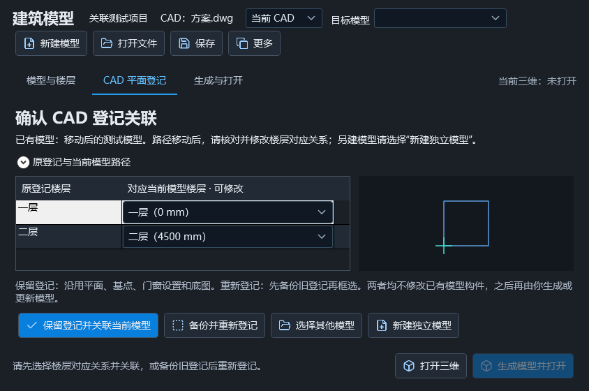
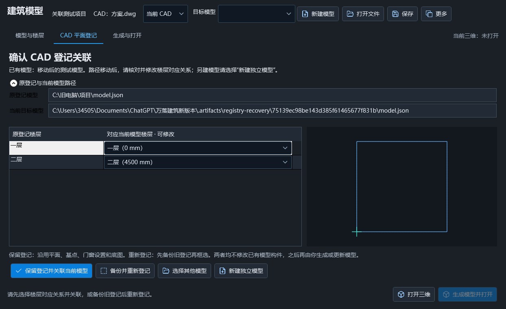

# CAD 登记关联修复与新建、更新分离

2026-10-25，仍为 1.5.6。用户本轮确认退出并授权备份覆盖，已完成安装及原目录回归。没有自动重新绑定或修改用户项目。

## 交互

此前登记文件只记录绝对模型路径，移动或复制模型后 Load 抛错，外层 CAD 弹出“楼层登记文件与当前建筑模型不匹配”。现在工作台接住可恢复的路径差异，显示“确认 CAD 登记关联”页面，保留 CAD 编辑能力。

- 显示目标模型名称、新旧路径、原登记平面预览、每组登记对应的当前模型楼层。小窗口将路径详情折叠，可展开和复制。
- 楼层对应可修改。无法匹配的楼层必须明确选择目标或“暂不关联”；不同组不能指向同一独立层，不把标准层引用误当独立来源。
- “保留登记并关联当前模型”：先完整备份旧登记，再更新登记路径、对应楼层身份及当前楼层标高/层高/标准层引用，保留 CAD XY、单位、基点、识别资料、门窗设置和底图，不改模型构件。
- “备份并重新登记”：保留旧登记的完整备份，重置登记和基点，回到逐层框选；模型构件仍保留，之后由用户点击生成/更新。
- “选择其他模型”及“新建独立模型”各走现有打开/创建流程。独立新建不携带旧构件、旧 CadImport 或旧登记，不写旧目标。已有生成记录的模型按钮明确为“更新模型并打开”，新模型使用生成/创建文案；待确认关联时禁用生成，普通保存也不会覆盖待处理登记。
- 关闭、取消或仅修改下拉选择不写入文件。提交前核对模型/登记快照，外部修改则提示刷新，避免覆盖其他窗口的更新。只访问当前文件旁的侧车，绝不往登记记录中的旧路径写入。

截图使用合成测试几何，未携带用户图纸或模型。

## 验证

- WPF 实际关联/重登/独立新建按钮、可编辑下拉、大/小窗口、完整备份、取消无写入、标高/标准层引用/XY/底图、已有手工构件保持、模型/登记外部改动保护通过。
- 原 CAD 登记/核心/WPF 工作台全套回归通过，保留同编号同洞口门窗做法、重新定位、重复生成和整次撤销等规则不变。
- 两个既有项目只读复制后验证：一个保留 5 组登记；另一份登记有 3 组、模型只有 2 个相应来源层，未匹配的一组必须明确选择后才能提交。仅在私有副本中测试明确不关联，原模型/登记字节保持。
- 正式 R24/R25 构建、两代全部 Ribbon 图标及工作台调用图标资源检查通过。首次 CAD 实机发现关联勾选图标未嵌入，已补两代资源，发布检查现在从工作台代码收集图标名，缺失即失败。
- 最终 R24 在 CAD 2022/2024 临时图纸的实际非模态窗口、原生 CAD 编辑、关联备份/重登、已有模型不变、独立新建/同名确认、取消拾取、异步保存、生成进度及文档切换保护通过；R25 不宣称本机 2026 实测。
- 正式 Studio 的项目新建/替换/保存回执/进度/一步撤销回归通过。源码未上传 GitHub。

## 安装

用户确认退出后复查无相关进程，12:04:05 完整备份原安装 350 文件，更新两代 CAD 插件、Studio 三个程序集及版本记录共 6 文件。344 原安装文件、自包含运行环境、75 项外部配置和三个既有项目的 60 个文件保持原样，项目关联由用户在新页面中自行选择。

安装后原目录 CAD 2022 临时图纸的非模态/实际关联按钮/备份重登/独立新建和既有全部工作台原生回归，以及原目录自包含 Studio 的项目新建/更新/替换/保存回执/进度/撤销窗口通过。再次核对保护文件与有效载荷哈希一致，测试会话退出。本机回滚备份位于 .artifacts/install-backup-registry-recovery-20261025-120348，不随源码上传。未上传 GitHub。
