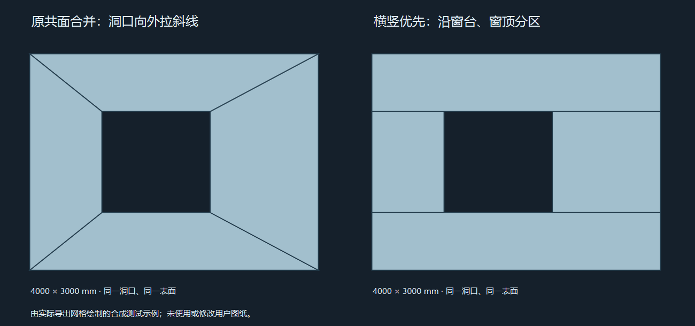

# FBX 墙面横竖布线

日期：2026-10-25。版本 **1.5.6**。状态：**已实现，正式包及回归通过，已备份覆盖原目录；未上传 GitHub**。

## 行为

用户要求窗洞四角尽量不要向墙角拉斜线。旧导出先三角化、再合并凸共面片，保留了洞口周围的梯形分区；本轮在 FBX 墙材质的平直墙面上增加横竖分区。

- 沿窗台、窗顶及门洞等实际边界高程扫成水平带，洞口两侧用竖线相接。旋转墙使用墙自身的水平轴与世界竖向，不把斜墙掰成世界 X/Y 方向。
- 仅处理无平滑分组、具有水平/竖直闭合边界的共面墙片。洞口保留为空，不挪动原顶点，不跨构件/材质焊接，不改模型、图纸、GLB 或 SKP 的中性几何。
- 横带与窗侧/端头/相邻横带相接时，在每个相邻多边形上插入相同的边界点，保持焊接，避免 T 形未连接边。
- 旋转墙的水平盖面插入边界点后，单精度误差可能使近共线点形成微小凹角。此时盖面使用经过面积和绕序检查的内部扇形分割，不把凹多边形交给 Max 猜测三角化；立面仍保留横竖分区。
- 曲墙、带斜边的墙面、分支/重合边界及超出预算的复杂片保留既有凸分区，不为布线外观阻断原本可导出的模型。原有精度、小面容错、取消、材质/身份及文件回读保护继续生效。
- 三维程序内部仍可使用三角网格；FBX 展示分区优先横竖，不保证内部三角形数量减少。必要的曲面/斜面/转角和盖面分割仍保留。
- 清单继续记录 `PlanarPartition=ConvexWithCornerCuts`，另增 `WallEdgeLayout=LocalHorizontalVerticalBandsWhenRectilinear` 表明墙面策略。

实际合成导出网格对比：

## 验证

- 新增 `FbxWallGridTests`：单洞/不同窗台及窗顶的多洞/落地门、镜像绕序、旋转墙、洞口及面积、墙端/窗侧闭合焊接、中性场景不变、斜边回退、取消、原生 FBX 保存和回读。
- 原有共面合并、凸转角/框料、精度容错、楼层图层/名称、50 层、提交恢复/跨进程锁回归通过。清单新增字段贯通检查通过。
- 用户本次“29号模型”仅使用既有导出快照副本：62 面墙、35 樘门窗，99 构件。独立 Blender 对照旧文件与新文件，竖直墙面的斜边 **201 → 0**，33 面墙改善，没有墙体斜边增加；原快照哈希未变。
- 29 号独立回读：3 个楼层图层，99 构件，1870 多边形；双向采样最大表面差约 **0.004784 mm**，最大相对面积差约 **1.4073e-7**，门窗开放边 0，凸分区通过。
- 旧 8# 失败快照：257 构件、192 中性网格、65590 源三角面，约 4.2 秒完成场景/文件生成与回读；原有 4 个单精度退化小面的警告仍正常贯通，不新增失败。独立 Blender：257 构件、13678 多边形，最大表面采样差约 **0.01945 mm**，最大相对面积差约 **2.8332e-7**，门窗开放边 0。原有重合墙盖面去重核算沿用旧规则。该快照本轮仅测 FBX，未宣称其 SKP 问题已修复。
- 正式 R24/R25 发布及两代 26 图标通过。暂存包原生 FBX/样例 SKP/实际快照/取消与旧输出保护通过；导出窗口大小布局、格式/范围切换、原生子进程及关闭取消检查通过。
- 独立 Blender 检查只读本机测试输出。Max 当前用户场景未操作，未宣称 Max 原生批处理或视口验收通过。

## 文件与安装边界

源码：`BuildingModel.ExportWorker/FbxWallGrid.cs`，在 FBX 写入器的墙材质共面合并后调用；不改变门窗框料、玻璃等其他材质的布线。普通墙与女儿墙沿用墙材质，同规则适用。

正式包：`dist/fbx-wall-grid-stage-20261025`。实际快照、诊断、比较输出和运行日志均在忽略的 `.artifacts` / 本机运行目录，不随源码上传。

用户首次确认后仍检测到“29号模型”窗口，未执行覆盖；用户再次确认模型退出并复查 CAD/模型/启动器均关闭后，**10:50:38** 完成安装。

- 完整备份并逐文件核对 350 文件，私有备份为 `.artifacts/install-backup-fbx-wall-grid-20261025-105023`，结果为 `.artifacts/install-fbx-wall-grid-20261025-result.json`。
- 只更新 `建筑模型/万落建筑模型.dll`、`建筑模型/WanLuo.ModelExport.dll` 和原 `build-info.json` 共 3 文件。核心程序集与暂存包完全相同，保留原 CAD 插件、启动器、自包含运行环境及 deps/runtimeconfig，347 个其他安装文件及 75 个外部业务配置哈希保持。
- 直接从原目录自包含 EXE 复测：导出窗口大小布局/格式/范围/取消通过；顺序原生 FBX、样例 SKP、实际 29 号、旧输出保护、清单及身份检查通过。
- 原目录导出的实际 29 号再经独立 Blender 核对：99 构件、3 图层、1870 多边形，表面/凸面/门窗开放边检查通过；62 面墙立面斜边仍为 **201→0**。测试程序均已退出，不结束或修改用户 Max 场景及其无窗口进程。

回归中曾在 `FbxDisplayLayers.Apply` 的临时 FBX 文件替换处遇到 `UnauthorizedAccessException`；原目录首次并发回归也出现一次，停止并发后完整顺序复测通过。该处临时文件处理代码本轮未改，尚未定位拒绝触发条件，不把重试成功当作 I/O 争用已修复。保留日志在私有 `.artifacts/fbx-wall-grid-20261025/installed-native.log` 与 `installed-native-retry.log`；文件错误仍真实上报并保护旧输出。

安装后需要重新导出 FBX、再导入 Max；旧 FBX 和现有 Max 场景不会自动改变。
