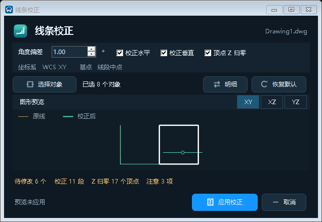

# 线条校正图标与窗口

日期：2026-10-24。版本保持 1.5.6。已完成源码、暂存包及回归；用户本轮确认关闭并复查进程后，13:26:34 已备份覆盖原安装目录。

## 窗口与入口

- `线条校正` 不再借用比例管理图标。专用图标用虚线斜边、实线直角和中点表达归正，与既有功能区徽标风格一致；16/32/128 DIP 均生成独立图像，更新图标缓存版本。
- 使用既有 `DpiAwareForm`、`CadDialogTheme` 及原按钮图标，保持功能区分组、命令 `WLLINECORRECT` 和别名 `XTJZ`。
- 参数集中在上方：角度偏差及步进、水平/垂直/Z 归零独立勾选；固定坐标系和基点作为只读参数呈现。支持恢复默认，保留已选对象。
- 原线虚线与校正结果叠加，按真实数据同比例适配，不夸大偏差；直线显示中点标记，闭合多段线保留闭合边。明细当前行联动高亮。XY/XZ/YZ 投影可查看标高变化；含弧段对象不伪画为直线，仍在明细显示状态。
- 大窗口同时显示图形和明细；短窗口切换预览/明细，保留完整参数、统计状态、取消和应用按钮。空选择不提供示例假几何、不可应用；仅 Z 模式禁用角度输入，无有效修改时不可应用。
- 明细沿用实际对象标识、段数、归零顶点、最大三维位移（图形单位）及跳过原因，颜色区分待改、无需修改和注意项。预览不写入 CAD。

## 验证

- `Build-Release.ps1` 最终 R24/R25 暂存发布完成；两代 26 个图标的尺寸/冻结/非空及专用图标校验通过。原安装和当前后台同步未被停止或覆盖。
- 纯几何回归通过：线段中点、投影长度、容差、公共顶点连接、闭合、弧段保护和 Z 开关。
- CAD 2022、2024 Core Console 的独立临时图纸创建 8 类测试对象，960x660、800x480、620x400 客户区实际控件显示/截图；检查控件无越界、表格高度、紧凑切换、投影、恢复默认、角度/Z 动态重算和列表高亮，取消/预览未写入。
- 真实 LINE、LWPOLYLINE、旧二维/三维多段线写入，宽度/属性/锁定层/弧段保护和一次撤销通过；测试设置恢复，临时会话退出，不打开用户项目图纸。
- 本轮没有修改几何求解和写入规则。没有做原生 R25 CAD 交互验收；R25 图标回归不等于原生 CAD 交互验收。

## 安装与复测

完整备份原安装 350 文件并逐项验证后，仅替换 `CadApi/R24/BatchPdfPublisher.dll`、`CadApi/R25/BatchPdfPublisher.dll` 和对应 `build-info.json`；保留原启动器、三维自包含运行时和其余 347 个安装文件，75 个外部配置文件哈希不变。版本记录保留原三维/启动器哈希与部署方式，更新 CAD 插件哈希并明确本次补丁标记，不将框架依赖暂存程序覆盖到已有自包含运行环境。

原目录 CAD 2022 临时图纸的大小窗口、参数切换、真实写入/属性保持与一步撤销复测通过；原目录 R24/R25 的 26 个图标检查通过。最终复查无 CAD/测试/模型/启动器进程。未修改用户 DWG 或模型，未再次上传 GitHub。

备份位于本机 `.artifacts/install-backup-line-correction-ui-20261024-20261024-132613`，安装结果为 `.artifacts/install-line-correction-ui-20261024-result.json`；私有备份和验证清单不上传。

## 实测截图

截图只含临时合成对象，不含用户图纸。

- [大窗口空选择](线条校正窗口-20261024/empty.png)
- [小窗口明细](线条校正窗口-20261024/compact-details.png)
- [小窗口图形预览](线条校正窗口-20261024/compact-preview.png)

