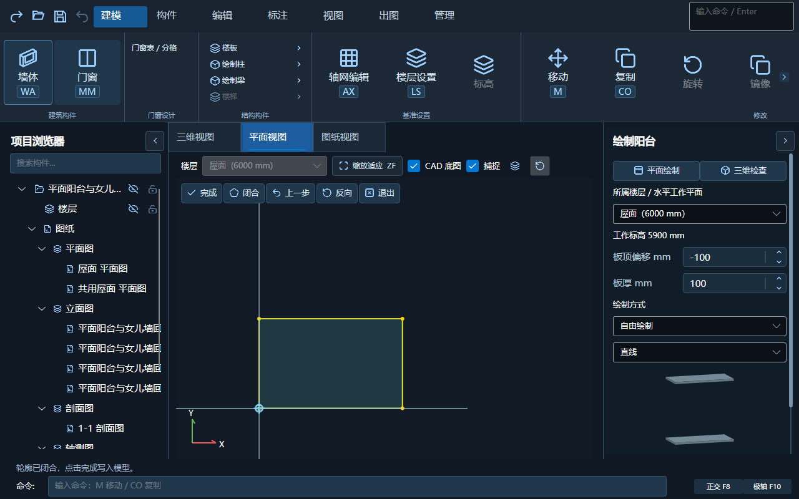
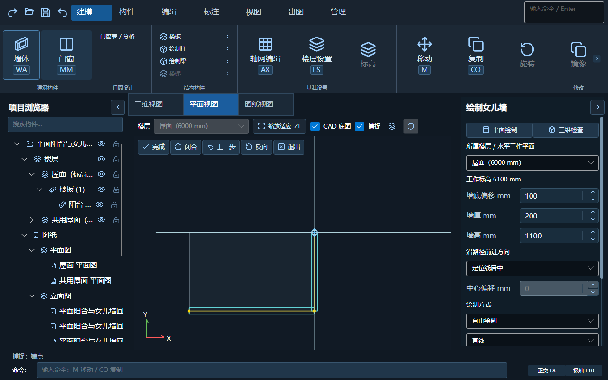
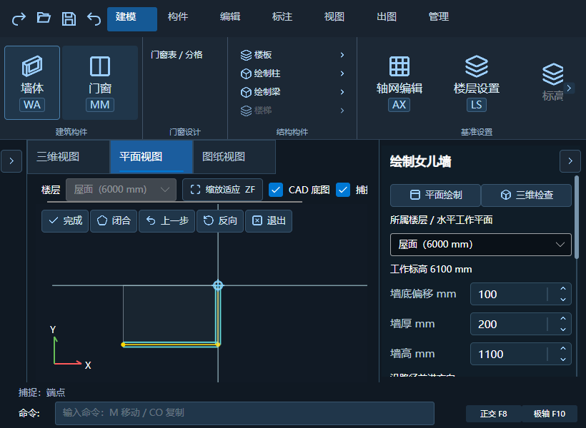

# 阳台与女儿墙平面绘制

日期：2026-10-24。安装更新：2026-10-25。版本 **1.5.6**。状态：源码实现、正式构建及窗口回归已通过，**已备份覆盖原安装目录，未上传 GitHub**。

## 使用流程

从既有“构件 → 室外与屋面”选择阳台或女儿墙，默认进入建筑模型的平面视图。女儿墙仍先使用墙体参数窗口；阳台直接进入绘制。

1. 右侧选择所属楼层，设置板顶偏移/板厚，或墙底偏移/墙厚/墙高及定位侧。
2. 在平面依次拾点，可画直线、三点圆弧，或使用逐边取线/取闭合周边。平面捕捉复用模型、轴网及已登记 CAD 底图；没有 CAD 也可独立画。
3. 阳台闭合后完成，女儿墙开放或闭合路径均可完成。上方提供完成、闭合、上一步、反向、退出，右键同一菜单；中键平移、滚轮缩放，F8/Shift 正交、F10 极轴沿用既有设置。
4. 右侧“平面绘制 / 三维检查”及原视图页签均可切换。两个视图共用同一份草稿、参数及工作标高，切换不提交、不清空节点，也不重置捕捉开关。
5. 完成后一次写入模型；Ctrl+Z 撤销整条已应用路径。绘制中 Ctrl+Z/Backspace 退一步，Esc 取消当前草稿，再次 Esc 退出；文本输入焦点不抢撤销。

顶部楼层框在工具期间只读，绘制楼层统一从右侧调整，并同步平面显示；已有阳台重绘锁定原楼层。共用层实例不静默转到来源层修改，仍提示选择来源或拆独立层。

## 实现

- 新增 `PlanEditorCanvas.Outdoor.cs`：平面坐标/捕捉、墙厚两侧及端头、阳台解析轮廓和洞口、草稿控制线与源边高亮。使用真实草稿几何，不另建语义模型。
- 平面拾点在普通选择、夹点和开洞工具之前分流，保持中键平移与滚轮缩放。退出清理绘制状态，不泄漏到普通编辑。
- 阳台重绘的原轮廓为灰虚线，隐藏旧板的平面实体填充；三维继续排除旧板及共用实例，避免新旧叠放。编号、洞口、随层顶及标准层规则沿用原提交逻辑。
- 平面取边只使用当前楼层可见、未冻结语义边；三维继续检查遮挡。首边采用源标高、解析 Bulge、反向、断口及一步草稿撤销规则不变。
- 同一楼层进入工具保留当前平面缩放与位置，不重复设置楼层导致用旧布局尺寸缩放。切换视图仅清理悬停/临时鼠标点，不删除确认节点。

## 验证

- 室外绘制核心：语义环、解析弧、标准层、阳台重绘身份/洞口、路径原子提交及回滚通过。
- `--smoke --outdoor-drawing-check --outdoor-reference-check`，1280×800、820×600：真实平面指针事件、CAD 普通线端点、无 CAD 的板端点、正交、缩放、闭合阳台、女儿墙动态参数、三点弧、共享三维预览、整圈悬停/复制、隐藏/冻结过滤、取消、一次提交/撤销、共用层保护通过。原三维拾点和语义取边/阳台重绘同批回归通过。
- 正式待安装包的独立快捷键回归通过；楼板与墙/门窗/楼板参数窗口回归通过。将所有测试开关合在一次进程运行时，最后快捷键总断言失败，单独运行通过；聚合用例的共享状态隔离尚需另行整理，不以聚合失败结果宣称全组合通过。
- 正式 R24/R25 发布构建及两代 26 个功能图标检查通过。新增代码均在 Studio，未改 CAD 登记、生成、导出语义或用户项目。
- 仅保留既有 Avalonia 分析器版本及 Bitmap API 警告，无新增编译错误。以下截图来自临时合成模型的实际窗口，不含用户图纸。

## 安装与边界

2026-10-25 用户本轮确认已关闭、可以备份覆盖。复查 CAD/模型/启动器/同步进程均退出后，00:02:02 完成原安装覆盖。

- 来源：正式构建 `dist/outdoor-plan-stage-20261024`。仍为 1.5.6。
- 完整备份并逐文件核对 350 个文件，备份在私有 `.artifacts/install-backup-outdoor-plan-20261025-000144`。安装结果保存在 `.artifacts/install-outdoor-plan-20261025-result.json`，不随源码上传。
- 核对两份依赖清单的包/项目版本相同，仅更新 `建筑模型/万落建筑模型.dll`、`WanLuo.BuildingModel.Core.dll`、`WanLuo.ModelExport.dll` 及原 `build-info.json` 共 4 文件。CAD 插件、启动器、自包含 apphost、运行时、deps/runtimeconfig 均保留；版本记录保留原 EXE/插件哈希并增加三个程序集的实际哈希。
- 346 个其余安装文件与 75 个外部业务配置逐项哈希未变，不改用户项目或图纸。
- 安装后直接启动原目录自包含 `万落建筑模型.exe`，运行 820×600 的 `--smoke --outdoor-drawing-check --outdoor-reference-check`。平面真实指针/底图捕捉/参数/圆弧/草稿共享/原子撤销、原三维拾点及语义边/阳台重绘检查全部通过，退出码 0；测试窗口和进程已退出。

本轮不新增栏杆、散水、泛水、宿主跟随、自动 CAD 生成或三维节点夹点。平面绘制仍复用现有阳台板和女儿墙语义，旧模型及标准层无需迁移。
